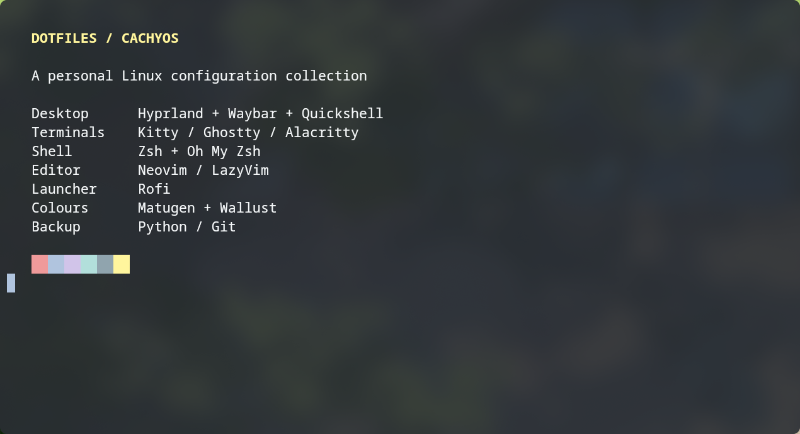
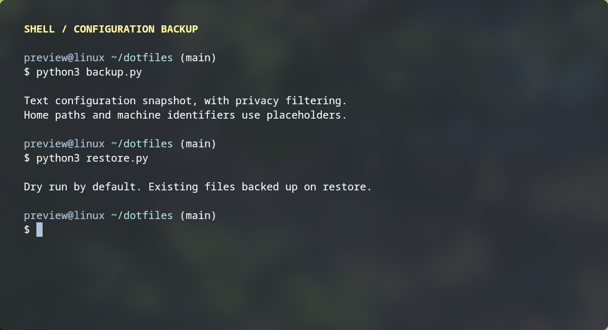

# Dotfiles

A privacy-filtered collection of CachyOS / Arch Linux configurations, built for backing up and rebuilding a Wayland desktop.

| Layer | Technologies |
| --- | --- |
| Desktop | Hyprland, Waybar, Quickshell / Qt Quick (QML), Rofi |
| Login screen & keymaps | SDDM / pixel-cyberpunk, console and X11 layouts, Hyprland keybindings |
| Terminal & shell | Kitty, Ghostty, Alacritty, Zsh, Oh My Zsh |
| Editor | Neovim, LazyVim, Lua |
| Appearance | Matugen, Wallust, GTK, Qt, Kvantum |
| Utilities | Fastfetch, btop, Cava, Yazi, notification and media tools |
| Backup | Python 3.9+ standard library, Git; no Python dependencies |

## Preview

Terminal screenshots from the current desktop, with illustrative content and an anonymous sample prompt.

## Snapshot

`home/` mirrors selected configuration paths. `manifest.json` lists backed-up files; `packages/` records explicitly installed native and AUR/foreign packages.

`system/` contains SDDM settings and text theme files, plus console/X11 keyboard settings. System files are **not** applied by `restore.py`; review and restore them manually with administrator permissions. SDDM autologin is excluded. The theme's background video and font are not bundled. Fastfetch includes the ASCII bonsai logo; alternative configurations also use it instead of external images.

Run `python3 backup.py` to refresh configurations. `python3 restore.py` previews a restore; add `--apply` to write files and save existing files under `~/.local/state/dotfiles-backups/`.

Home paths, username and hostname use placeholders resolved at restore time. Browser profiles, account stores, Git identity, SSH/GPG keys, shell history, caches, binary assets and files matching credential patterns are excluded. This is **not a complete system backup**: packages, fonts, wallpapers and Oh My Zsh itself must be installed separately, and omitted files may need manual recreation.

Filtering cannot guarantee the absence of private data. Review changes before publishing. Bundled configuration, artwork and third-party scripts retain their upstream rights; verify artwork redistribution permission before publishing.
